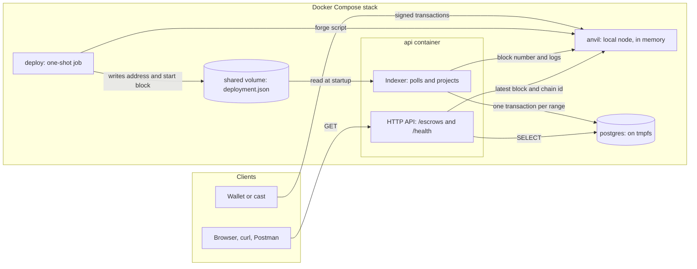
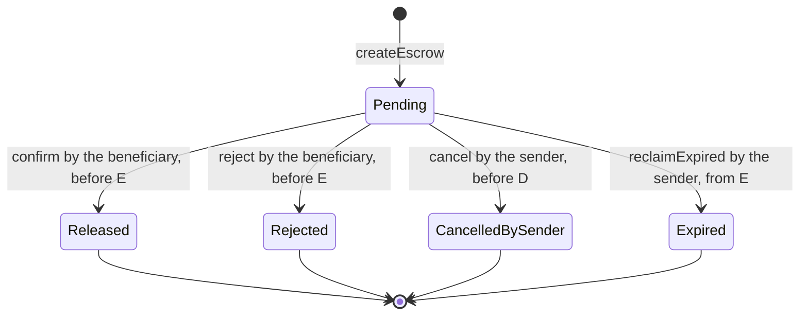
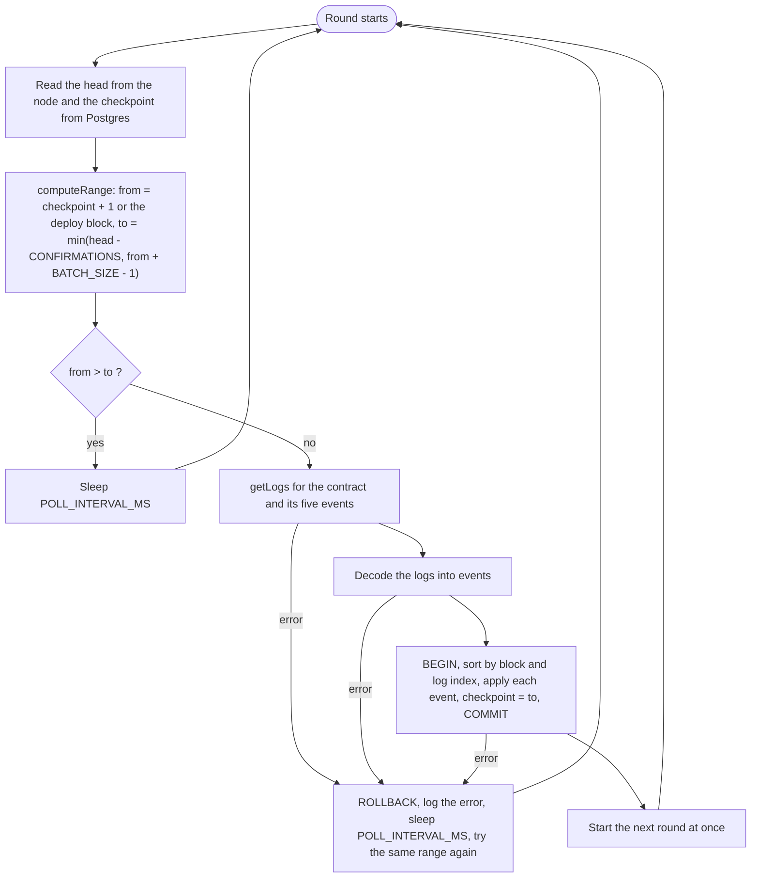
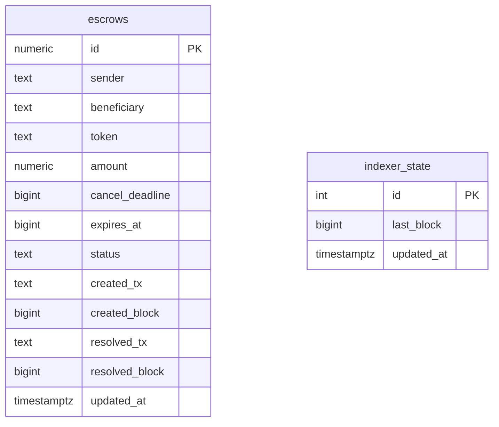
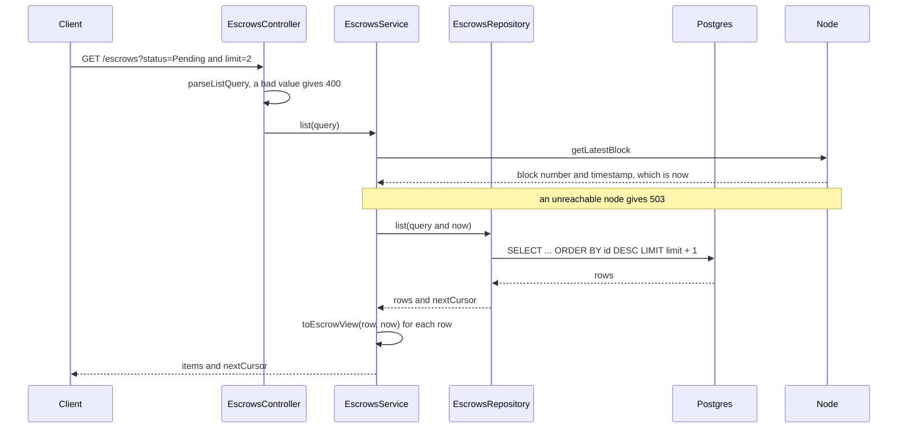
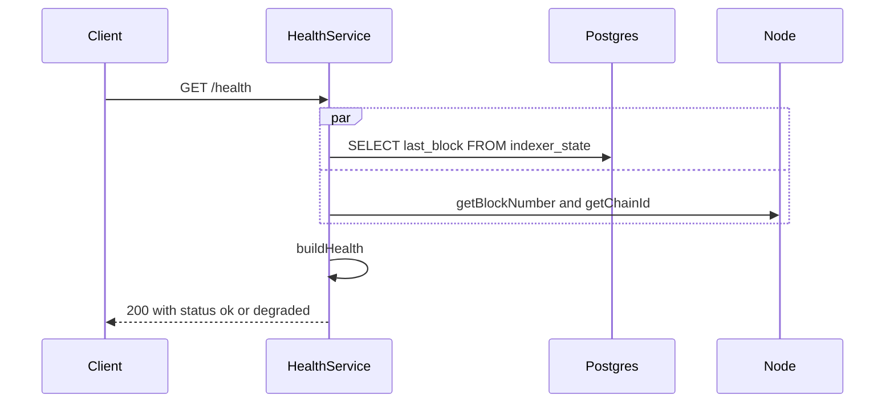

# Architecture

How the pieces fit together. [SPEC.md](SPEC.md) defines the rules and this document shows where they live in the code. The diagrams are Mermaid and render on GitHub. Paths are relative to the repository root, except in the file map at the end, where bare names sit inside the folder named in the same row. Last checked against the code on 2026-11-09.

The idea in one paragraph: the contract is the source of truth. An indexer inside the API reads its events, waits for confirmations, and writes a projection into Postgres in one transaction per range of blocks. The HTTP API reads only that projection, plus the clock of the latest block, so it never writes and never signs anything.

## 1. Components

| Component | What it does | Code |
| --- | --- | --- |
| Contract | Holds the escrows and enforces every rule. No owner, no upgrade, no rescue | `contracts/src/EscrowManager.sol` |
| `deploy` | Deploys the contract, converts the hex deploy block to decimal, writes `{ "address", "startBlock" }` through a temporary file and a rename | `contracts/deploy.sh`, `contracts/script/Deploy.s.sol`, `contracts/Dockerfile` |
| Indexer | Reads confirmed logs and projects them. Starts with the app and stops before the database pool closes | `api/src/indexer/` |
| HTTP API | Reads the projection and the node's clock. Read only | `api/src/escrows/`, `api/src/health/` |
| Postgres | Two tables, created at startup with `IF NOT EXISTS` | `api/src/database/schema.sql`, `schema.ts` |
| Stack | Start order is enforced by health checks and `service_completed_successfully` | `docker-compose.yml` |

Both the indexer and the health check use the deployment file: the indexer for the first block to read, `/health` for the lag before the first checkpoint.

## 2. Escrow lifecycle

With `c` the creation time, `D = c + 2 hours` (`CANCEL_WINDOW`) and `E = c + 7 days` (`TTL`). "Before" is strict and "from" is inclusive, so at exactly `E` only `reclaimExpired` works:

| `now` | A `Pending` escrow can be |
| --- | --- |
| `now < D` | cancelled by the sender, confirmed or rejected by the beneficiary |
| `D <= now < E` | confirmed or rejected by the beneficiary |
| `now >= E` | reclaimed by the sender. The API shows `effectiveStatus: PendingExpired` |

`PendingExpired` exists only in API responses. Nothing writes it: the contract still says `Pending` until someone calls `reclaimExpired`. The order of the contract's checks (not found, not pending, wrong caller, wrong time) is fixed in SPEC §2.4 and tested in `contracts/test/`.

## 3. One round of the indexer

Two details that matter. After progress there is no sleep, so a backlog is cleared range by range without pauses. After an error the same range is tried again, which is safe because nothing from the failed round was kept.

What each event writes (`api/src/indexer/projection.ts`):

| Event | Statement | Columns |
| --- | --- | --- |
| `EscrowCreated` | `INSERT ... ON CONFLICT (id) DO NOTHING` | all of `id`, `sender`, `beneficiary`, `token`, `amount`, `cancel_deadline`, `expires_at`, `created_tx`, `created_block`, with `status = 'Pending'`. Addresses are lowercased |
| `EscrowReleased` | `UPDATE ... WHERE id = $1 AND status = 'Pending'` | `status = 'Released'`, `resolved_tx`, `resolved_block`, `updated_at` |
| `EscrowRejected` | same | `status = 'Rejected'` and the same columns |
| `EscrowCancelled` | same | `status = 'CancelledBySender'` and the same columns |
| `EscrowExpired` | same | `status = 'Expired'` and the same columns |
| every range | upsert of the row `id = 1` in `indexer_state` | `last_block = to`, `updated_at` |

## 4. Data model

The tables are not related. `indexer_state` holds a single row (`CHECK (id = 1)`) with the last block fully indexed. In `escrows`, `id` and `amount` are `numeric` so they hold any `uint256` (`amount` is `numeric(78,0)`); `resolved_tx` and `resolved_block` are null while the escrow is `Pending`; addresses carry a `CHECK` that they are lowercase; and there are indexes on `sender`, `beneficiary` and `status`. There is no table of raw events (SPEC §3.2).

## 5. Requests

`GET /escrows/:id` is the same path for one row: `parseEscrowId` (400), `findById` (404), then the node's clock (503) and `toEscrowView`. The `status` filter uses the same `now` as the response, so a list never disagrees with its own items (`statusCondition` in `api/src/escrows/escrows.repository.ts`).

`/health` always answers 200. It is `degraded` when the node cannot be reached or when `head - lastIndexedBlock > CONFIRMATIONS + HEALTH_MAX_EXTRA_LAG_BLOCKS`. Before the first checkpoint the lag is counted from `startBlock - 1`. The decision is the pure function `buildHealth` in `api/src/health/health.ts`.

## 6. Guarantees and where they come from

| Guarantee | How it is kept | Code | Test |
| --- | --- | --- | --- |
| Replaying events changes nothing | `ON CONFLICT DO NOTHING` on create, `WHERE status = 'Pending'` on every transition | `api/src/indexer/projection.ts` | `api/src/indexer/projection.spec.ts`: "replaying a range is a no-op" |
| A range is all or nothing | One transaction holds the events and the checkpoint, and rolls back on any error | `applyRange` in `api/src/indexer/projection.ts` | `api/src/indexer/projection.spec.ts`: "rolls back the whole range" |
| Events apply in chain order | Sorted by `(blockNumber, logIndex)` inside `applyRange`, whatever order they arrive in | `compareByPosition` in `api/src/indexer/projection.ts` | `api/src/indexer/projection.spec.ts`: ordering tests |
| Only confirmed blocks are read | `to` never passes `head - CONFIRMATIONS` | `api/src/indexer/range.ts` | `api/src/indexer/range.spec.ts` |
| A restart loses nothing | The checkpoint is in Postgres and a failed round is retried | `api/src/indexer/indexer.service.ts` | `api/src/indexer/indexer.service.spec.ts` |
| The indexer reads the right events | The ABI is pinned to the hashes of the contract's signatures | `api/src/indexer/escrow.abi.ts` | `api/src/indexer/decode.spec.ts`: "same event signatures as the contract" |
| The app does not start half configured | Settings and the deployment file are validated at boot | `api/src/config/config.ts`, `api/src/config/deployment.ts` | `api/src/config/config.spec.ts`, `api/src/config/deployment.spec.ts`, `api/test/app.e2e-spec.ts` |
| Locked amount equals the event amount | Balance before and after the deposit, otherwise `UnsupportedToken` | `contracts/src/EscrowManager.sol` | `contracts/test/CreateEscrow.t.sol` |
| A resolved escrow never changes | Status is written before any outbound transfer, guarded by `ReentrancyGuard` | `contracts/src/EscrowManager.sol` | `contracts/test/ResolvedEscrowFinality.t.sol`, invariants I1 to I3 in `contracts/test/invariant/` |
| Tokens sent directly to the contract are not attributed | Escrow amounts are stored, never read from the balance | `contracts/src/EscrowManager.sol` | `contracts/test/DirectTokenTransfer.t.sol` |

### Time

The contract uses `block.timestamp`. The API uses the timestamp of the node's latest block as `now`, and never the server's clock (`EscrowsService` in `api/src/escrows/escrows.service.ts`). That is why moving Anvil's time with `evm_increaseTime` and `evm_mine` changes the API's answers at once, with no indexing needed, and why `e2e.sh` can test expiry in seconds. The derived fields (`canCancel`, `canConfirm`, `canReject`, `canReclaim`, `effectiveStatus`) are one pure function, `toEscrowView` in `api/src/escrows/escrow-view.ts`, tested at `D - 1`, `D`, `E - 1` and `E`.

### Startup and shutdown

Nest builds the modules in this order: configuration (`.env` through `@nestjs/config`, validated in `config.ts`, then the deployment file), the database (pool, then the schema), the indexer, then the HTTP routes. The indexer loop starts after the application has bootstrapped. On shutdown the loop stops first (`onModuleDestroy`, which also wakes its sleep) and the pool closes afterwards (`onApplicationShutdown`), so no round is cut off by a closed pool.

## 7. Left out on purpose

* **Reorgs deeper than `CONFIRMATIONS`.** The database would be wrong. There are no block hashes and no raw event table to rebuild from (SPEC §3.3).
* **Backoff in the indexer.** A failed round waits one `POLL_INTERVAL_MS` and retries forever. viem already retries single requests a few times (comment in `indexer.service.ts`).
* **Caching.** Every escrow request makes one RPC call for the latest block.
* **Several indexers on one database.** Replays are harmless, so it would work, but the work would be done twice.
* **Admin functions and unusual tokens.** No owner, pause, upgrade or rescue function. Fee-on-transfer and rebasing tokens are not supported. Tokens with blacklists can lock refunds (SPEC §2.5).
* **Permit creation.** Specified in SPEC §2.3 and planned as T-12 in [TASKS.md](TASKS.md), not implemented yet. It will add a second entry point to the contract that emits the same event, so the indexer and the API will not change.
* **Docker stack and `e2e.sh` in CI.** They run by hand. CI runs the contract tests, Slither, and the API lint, build and tests.

## 8. Where to look

| Area | Files |
| --- | --- |
| Contract and tests | `contracts/src/EscrowManager.sol`, `contracts/test/`, `contracts/test/invariant/` |
| Deploy | `contracts/deploy.sh`, `contracts/script/Deploy.s.sol`, `contracts/Dockerfile` |
| Configuration | `api/src/config/` |
| Database | `api/src/database/schema.sql`, `api/src/database/schema.ts`, `api/src/database/database.module.ts` |
| Indexer | `api/src/indexer/`: `range.ts`, `chain-reader.ts`, `escrow.abi.ts`, `decode.ts`, `projection.ts`, `indexer.service.ts` |
| Endpoints | `api/src/escrows/`: `query.ts`, `escrows.repository.ts`, `escrows.service.ts`, `escrow-view.ts`, `escrows.controller.ts` |
| Health | `api/src/health/health.ts`, `health.service.ts`, `health.controller.ts` |
| Stack and checks | `docker-compose.yml`, `e2e.sh`, `.github/workflows/ci.yml` |
| Related documents | [SPEC.md](SPEC.md), [TASKS.md](TASKS.md), [slither.md](slither.md), [manual-test.md](manual-test.md), [postman/](postman/), [ai/](ai/) |
